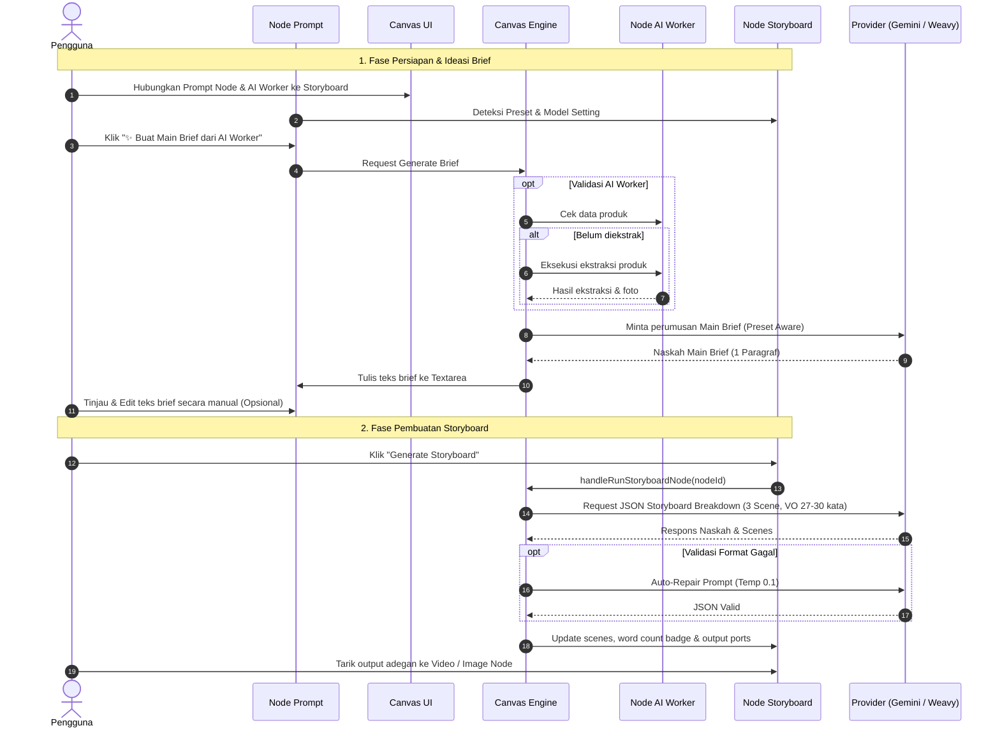

# Product Requirement Document (PRD)
## Modul: Canvas Menu — Node Storyboard Copilot & Smart Main Brief Generator

| Dokumen | Spesifikasi Kebutuhan Produk (PRD) |
|---|---|
| **Fitur** | Node Storyboard Copilot & Smart Main Brief Generator di Node Prompt |
| **Versi** | 1.1 (Draft) |
| **Tanggal** | 10 November 2026 |
| **Status** | Disetujui untuk Masuk PRD (Menunggu Instruksi Implementasi) |

---

## 1. Ringkasan Eksekutif & Tujuan (Executive Summary)

### 1.1 Latar Belakang
Pembuatan konten video pendek berbasis AI (TikTok Shop, Shopee Video, Reels) membutuhkan orkestrasi berurutan: mulai dari riset produk, perumusan hook & formula naskah, perhitungan pacing voiceover, hingga pembuatan prompt gambar/video per adegan.

Pada alur Canvas sebelumnya, melompat langsung dari data mentah **AI Worker** (spesifikasi produk e-commerce) ke **Storyboard Copilot** (3 adegan video lengkap) memberikan beban kognitif terlalu berat pada model AI dan menghilangkan kesempatan pengguna untuk menyelaraskan *angle* kreatif.

Oleh karena itu, diperkenalkan jembatan kreatif cerdas: **Smart Main Brief Generator** pada **Node Prompt**. Ketika Node Prompt tersambung ke Storyboard Copilot, ia bertindak sebagai kurator konsep naskah yang membaca data produk dari AI Worker dan formula dari Storyboard Copilot untuk merumuskan konsep cerita (*Main Brief*) yang dapat ditinjau dan diedit pengguna sebelum adegan dipecah.

### 1.2 Tujuan Produk
1. **Otomatisasi Sutradara Konten**: Menganalisis brief atau produk e-commerce dan memecahnya ke dalam adegan berdurasi presisi (biasanya 10 detik per adegan).
2. **Sinergi 3-Node (AI Worker $\to$ Prompt Node $\to$ Storyboard Copilot)**: Menghilangkan keharusan mengetik brief manual tanpa kehilangan kendali (*human-in-the-loop*).
3. **Pacing Voiceover Ketat**: Memastikan voiceover berada pada batas ideal 27–30 kata per adegan agar tidak terpotong saat diucapkan pada durasi 10 detik.
4. **Penyaluran Reaktif (Reactive Graph Flow)**: Menyediakan port output dinamis per adegan (`sceneX_image` dan `sceneX_video`) yang dapat langsung ditarik ke model gambar dan video tanpa copy-paste manual.
5. **Efisiensi Biaya & Zero-Config**: Pengambilan ide naskah di Node Prompt otomatis meminjam preferensi model/provider dari Storyboard Copilot (Google AI Direct 0 kredit atau Weavy 1 kredit).

---

## 2. Persona Pengguna & Alur Kerja (User Persona & Workflows)

### 2.1 Persona
- **Kreator Konten & Affiliate Marketer**: Ingin membuat variasi video promosi produk secara cepat dengan hook kuat dan ritme visual yang menarik.
- **Brand Owner & Advertiser**: Membutuhkan naskah iklan berbasis data faktual produk (USP, harga, fitur) tanpa halusinasi klaim.

### 2.2 Alur Kerja Utama Terintegrasi (Primary 3-Tier Workflow)

```
[ 1. AI Worker ] ──────────────┐
(Ekstraksi Link Produk)        ▼
                         [ 3. Storyboard Copilot ]
[ 2. Node Prompt ] ────────────┘ (Setting: Preset, Model, Provider)
(Tombol: [✨ Buat Main Brief])
```

1. **Persiapan Node**:
   - Pengguna menaruh node **AI Worker** (isi link produk).
   - Pengguna menaruh node **Storyboard Copilot** (pilih preset, misal `/facelessgardenugc` atau `/buahunggul`).
   - Pengguna menaruh node **Prompt** dan menyambungkan kabel outputnya ke port `input-brief` pada Storyboard Copilot.
2. **Perumusan Konsep (Smart Brief Generation)**:
   - Node Prompt mendeteksi kabel tersambung ke Storyboard Copilot dan melihat keberadaan AI Worker.
   - Muncul tombol cerdas di Node Prompt: **`[ ✨ Buat Main Brief dari Produk ]`**.
   - Pengguna mengklik tombol tersebut. Sistem mengecek status AI Worker (auto-run jika belum selesai), lalu AI merumuskan 1 paragraf ringkas konsep hook & angle cerita sesuai preset.
   - Hasil brief langsung tertulis ke dalam *textarea* Node Prompt.
3. **Review & Penyesuaian Manual**:
   - Pengguna membaca Main Brief di Node Prompt, lalu bebas mengedit kata, menambahkan info diskon, atau mengubah gaya bahasa jika diperlukan.
4. **Eksekusi Storyboard Penuh**:
   - Pengguna menekan tombol **Generate Storyboard** di Storyboard Copilot.
   - Naskah adegan (scenes, sub-shots, voiceover 27–30 kata) disusun secara otomatis.
5. **Penyaluran Visual**:
   - Pengguna menarik port adegan ke node render gambar & video atau menekan **Auto-Spawn Pipeline**.

---

## 3. Spesifikasi Fungsional (Functional Specifications)

### 3.1 Skema Data Node (`StoryboardNodeData`)

```typescript
export interface StoryboardNodeData {
  // Identitas & Konsep
  presetKey?: string;               // e.g. '/facelessgardenugc', '/buahunggul'
  generatedPresetKey?: string;
  projectTitle?: string;
  productName?: string;
  productDesc?: string;
  modelTalent?: string;
  bgSetting?: string;
  brief?: string;
  
  // Konfigurasi Teknis
  targetDuration?: number;          // Default 20-30s
  aspectRatio?: string;             // Default '9:16'
  formula?: string;
  generatorMode?: 'director' | 'preset'; // Default 'preset' atau 'director'
  formulaAngle?: string;
  tiktokStyle?: string;
  hookPattern?: string;
  lockConsistency?: boolean;
  numScenes?: number;
  
  // Provider & Akun
  provider?: 'gemini' | 'weavy';    // Default 'weavy'
  model?: string;                   // e.g. 'gemini-3.6-flash' atau 'google/gemini-3.6-flash'
  modelDisplayName?: string;
  accountId?: string;
  accountEmail?: string;
  creditsCost?: number;             // 0 untuk Gemini, 1 untuk Weavy
  
  // Status & Output
  scenes?: StoryboardCopilotScene[];
  status?: 'idle' | 'running' | 'completed' | 'error';
  progress?: number;
  errorMessage?: string;
  rawJson?: string;
  activeTab?: number;
  analysis?: {
    hookAnalysis?: string;
    productOrTopicName?: string;
    coreUSPs?: string[];
    visualProofStrategy?: string;
    callToActionAnalysis?: string;
  } | null;
  masterProductionSheetPrompt?: string | null;
}
```

### 3.2 Spesifikasi Input & Kebijakan Grounding
- **Port `input-brief` (`text`)**: Menerima instruksi kreatif atau konsep tema (dari Node Prompt).
- **Port `input-ai-worker` (`text`)**: Menerima konteks faktual produk hasil ekstraksi AI Worker.
- **Port `input-image` (`image`)**: Menerima referensi gambar produk untuk menjaga konsistensi visual.
- **Aturan Validasi Eksekusi (Grounding Check)**:
  - Eksekusi Storyboard **wajib** memiliki minimal 1 input tersambung (baik Prompt maupun AI Worker).
  - Jika AI Worker terhubung tetapi belum dijalankan atau tautan produk berubah, Storyboard secara otomatis menjalankan AI Worker terlebih dahulu sebelum menyusun naskah.

### 3.3 Fitur Sinergi: Smart Main Brief Generator pada Node Prompt

Ketika kabel dari Node Prompt terhubung ke Storyboard Copilot:
1. **Deteksi Konteks Otomatis**:
   - Mendeteksi ID Storyboard target.
   - Membaca preset yang aktif di Storyboard (misal `/buahunggul`, `/facelessgardenugc`).
   - Membaca provider & model AI yang dipilih pada Storyboard (Gemini Direct / Weavy).
   - Mendeteksi node AI Worker yang juga terhubung ke Storyboard tersebut.
2. **Alur Eksekusi 2-Tahap**:
   - **Tahap 1 (Validasi Data Produk)**: Jika node AI Worker yang tersambung belum selesai diekstraksi, sistem secara otomatis mengeksekusi ekstraksi AI Worker terlebih dahulu.
   - **Tahap 2 (Ideasi Naskah Kreatif)**: Mengirimkan instruksi ke model AI:
     > *"Bertindaklah sebagai Creative Strategist Video Iklan Pendek. Analisis data produk AI Worker berikut, lalu rumuskan 1 paragraf Main Brief yang memuat: Hook utama, Solusi/USP produk yang didukung data, dan Call-to-Action. Selaraskan sudut pandang cerita secara ketat dengan aturan Preset [{presetKey}]. Jangan membuat breakdown scene pada tahap ini; hanya buat 1 paragraf konsep cerita ringkas."*
3. **Pemisahan Input User vs Output AI (Non-Destructive)**:
   - Arahan/brief yang diketik pengguna tersimpan permanen di field `prompt` dan **tidak pernah ditimpa oleh AI**.
   - Hasil rumusan AI disimpan di field terpisah `aiOutput`.
   - **Aliran ke Storyboard**: Jalur kabel ke Storyboard Copilot otomatis memprioritaskan `aiOutput` jika sudah di-generate, dan otomatis kembali ke `prompt` asli bila di-reset.
4. **Fitur Reset Output AI**:
   - Terdapat tombol `Reset` di Node Prompt yang hanya muncul saat hasil AI sudah ada.
   - Mengklik `Reset` membersihkan `aiOutput`, menyembunyikan tab, dan mengembalikan data yang mengalir ke Storyboard ke arahan asli pengguna.

### 3.4 Mode Generator Storyboard
1. **Mode Director (`director`)**:
   - Engine: `storyboardDirector.ts`.
   - Menggunakan kontrak JSON terstruktur murni (`metadata`, `analysis`, `scenes`, `masterProductionSheetPrompt`).
   - Menyediakan parameter variasi visual TikTok (*UGC Handheld*, *iPhone POV*, *Macro Texture*, dll.) dan formula hook (*Pattern Interrupt*, *Negative Fear*, dll.).
   - Menerapkan *character & product consistency locking* antar-scene.
2. **Mode Preset Chat (`preset`)**:
   - Format tradisional berbasis tag ```storyboard_project ... ```.
   - Mengikuti aturan template slash preset (`/facelessgardenugc`, `/buahunggul`, dll.).

### 3.5 Provider AI & Manajemen Kuota
| Provider | Biaya | Deskripsi |
|---|---|---|
| **Google AI Direct (Gemini)** | **0 Credit (Gratis)** | Menghubungkan langsung ke akun Google/API Key via lease management, mendukung rotasi multi-akun. |
| **Weavy Multi-LLM Hub** | **1 Credit Weavy** | Menghubungkan ke Weavy API / Extension Bridge untuk akses Claude 3.5 Sonnet, GPT-4o, dan model tier tinggi. |

*(Biaya pembuatan Main Brief di Node Prompt mengikuti model & provider yang aktif di Storyboard Copilot).*

### 3.6 Port Output Dinamis
Dihitung secara dinamis berdasarkan durasi rencana atau jumlah scene yang dihasilkan:
- `scene{N}_image`: Teks prompt untuk keyframe visual (gambar adegan ke-N).
- `scene{N}_video`: Teks prompt gabungan adegan + kamera + sub-shots untuk model video adegan ke-N.
- Port `output-script` disembunyikan di Canvas agar kabel visual terfokus pada adegan per adegan.

---

## 4. Spesifikasi UI/UX & Interaksi Canvas

### 4.1 Tampilan Node Prompt (Kondisi Terhubung ke Storyboard)
- **Header**: Tetap minimalis dan bersih (hanya icon `T` dan teks `Prompt` tanpa badge tambahan).
- **Kondisi Sebelum Generate (Idle)**:
  - Tampilan 100% bersih tanpa tab: hanya textarea tempat mengetik arahan, tombol `+ Add variable`, dan tombol **`→ Generate`**.
- **Kondisi Setelah Generate (Output AI Tersedia)**:
  - Muncul tab switcher minimalis di atas textarea:
    - **`[ Arahan Saya ]`**: Menampilkan teks ketikan asli pengguna (bisa diedit kapan saja).
    - **`[ Hasil AI ]`**: Menampilkan naskah Main Brief hasil rumusan AI (berwarna aksen amber, dapat disunting langsung).
  - Terdapat tombol **`Reset`** (ikon Refresh) di sisi kanan tab untuk menghapus hasil AI dan kembali ke tampilan awal.
- **Footer**:
  - Saat di tab `Arahan Saya`: Menampilkan `+ Add variable`, jumlah karakter prompt, dan tombol `Generate`.
  - Saat di tab `Hasil AI`: Menampilkan penanda `● Terkirim ke Storyboard`, jumlah karakter hasil AI, dan tombol `Regenerate`.

### 4.2 Tampilan Node Storyboard Copilot
1. **Header**:
   - Ikon Clapperboard / Film dengan aksen warna `amber`.
   - Judul: "Storyboard Copilot", subjudul menampilkan nama preset dan durasi target.
2. **Body**:
   - **Kondisi Kosong (Idle)**: Menampilkan status kesiapan, ringkasan brief yang terhubung, dan panduan konfigurasi.
   - **Kondisi Selesai (Completed)**:
     - Tab navigasi scene (`Scene 1`, `Scene 2`, dst.).
     - Badge kepatuhan kata voiceover:
       - 🟢 **Hijau (27–30 kata)**: Ideal untuk 10 detik.
       - 🟡 **Kuning (<27 kata)**: Terlalu singkat.
       - 🔴 **Merah (>30 kata)**: Terlalu panjang / resiko terpotong.
     - Ringkasan visual adegan dan daftar sub-shots (aksi 2–3 detik).
     - Kotak naskah voiceover dengan tombol salin cepat.
3. **Footer**:
   - Tombol **Reset** (non-destruktif: hanya membersihkan hasil scene tanpa melepas kabel input).
   - Tombol **Salin Scene**.
   - Tombol utama **Generate / Regenerate**.

### 4.3 Inspector Panel (Panel Sisi Kanan)
- Dropdown Preset Video.
- Toggle Mode Generator (`Director` vs `Preset Chat`).
- Pemilihan Provider AI & Selektor Akun Gemini / Weavy.
- Input parameter produk opsional (nama produk, talent/model, background setting).
- Pilihan Formula Angle, Gaya Visual TikTok, Hook Pattern, dan estimasi durasi/scene.
- Pengukur aturan Voiceover Ketat.

### 4.4 Interaksi Cerdas (Smart Canvas Features)
1. **Quick-Connect & Wire Drag-to-Empty**:
   - Menarik kabel dari port `sceneX_video` atau `sceneX_image` ke area kanvas kosong akan memunculkan menu instan untuk membuat node `imageModel`, `geminiVideo`, atau `vidsVideo`.
   - Node yang baru dibuat otomatis mengadopsi rasio aspek, teks prompt, naskah suara, dan metadata adegan bersangkutan.
2. **Auto-Spawn Full Scene Pipeline (`handleSpawnSceneNodes`)**:
   - Satu klik untuk mengekspansi seluruh adegan ke kanvas secara horizontal:
     $$\text{Storyboard} \longrightarrow \text{Image Model (Nano Banana Pro)} \longrightarrow \text{Viewer} \longrightarrow \text{Gemini Video} \longrightarrow \text{Video Stitcher (FFmpeg)}$$
3. **Mekanisme Auto-Repair**:
   - Jika LLM mengembalikan format teks/markdown bebas yang gagal diparsing, sistem otomatis mengirimkan instruksi perbaikan format (repair call) 1x pada temperature 0.1 tanpa memunculkan error ke pengguna.

---

## 5. Arsitektur Alur Data (Data Flow Architecture)



---

## 6. Rencana Pengembangan Selanjutnya (Next Iteration)
*(Menunggu instruksi lanjutan dari pengguna untuk modul/node Canvas berikutnya yang akan dimasukkan ke dalam PRD).*
