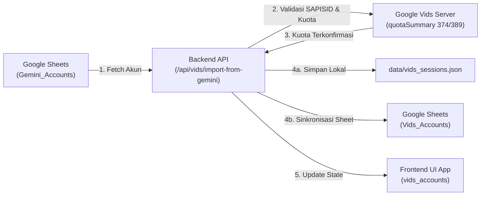
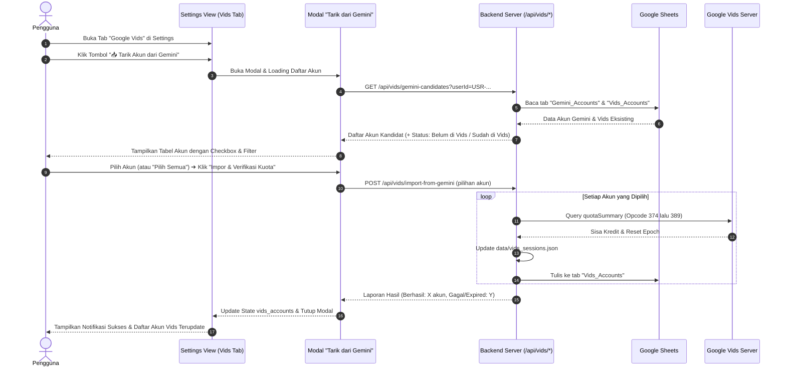

# PRD: Sinkronisasi & Penarikan Akun dari Gemini Sheets ke Google Vids via App

> **Status:** Draft / Ready for Review  
> **Target Release:** v8.x  
> **Komponen:** `GlobalSettingsView.tsx`, `server/routes/providerAccounts.ts`, `server/routes/vids.ts`, `server/utils/sheets.ts`  
> **Tipe Fitur:** Cross-Provider Account Migration & Automated Quota Provisioning

---

## 1. Executive Summary & Problem Statement

### 1.1 Latar Belakang
Pengguna aplikasi AMB Media telah mendaftarkan puluhan hingga ratusan akun Google Workspace dan Consumer ke provider **Google Gemini** yang tersimpan di Google Sheets pada tab `Gemini_Accounts`. 

Berdasarkan pengujian teknis RPC Google, akun Google yang terdaftar di Gemini Web memiliki cookie sesi gabungan (`SAPISID`, `SID`, `__Secure-1PSID`, `__Secure-1PAPISID`, dll) yang **100% valid dan langsung kompatibel** dengan layanan **Google Vids** (`appsgenaiserver-pa.clients6.google.com`). 

### 1.2 Masalah Saat Ini
1. **Redundansi Input Pengguna**: Untuk menggunakan akun yang sama di Google Vids, pengguna saat ini harus login ulang via Playwright atau mengekstrak cURL baru satu per satu dari `docs.google.com/videos`.
2. **Potensi Kuota Terbuang**: Banyak akun Google Workspace di tab `Gemini_Accounts` yang sebenarnya memiliki **500 kredit kuota video Google Vids** yang belum tersentuh sama sekali.
3. **Ketidaksinkronan Data**: Tab `Gemini_Accounts` dan `Vids_Accounts` di Google Sheets saat ini terisolasi, mengharuskan input manual ganda.

### 1.3 Solusi yang Ditawarkan
Membangun fitur **"Tarik / Impor Akun dari Gemini"** langsung di antarmuka aplikasi (**Settings ➔ Google Vids**):
- Menarik daftar akun dari tab `Gemini_Accounts` di Google Sheets.
- Melakukan verifikasi otomatis kuota Google Vids (Opcode 374 untuk Workspace / 389 untuk Consumer).
- Mendaftarkan akun-akun yang valid ke:
  1. File lokal server `data/vids_sessions.json`.
  2. Tab `Vids_Accounts` di Google Sheets.
  3. `localStorage` browser (`vids_accounts`).



---

## 2. User Stories & Alur Pengguna (User Flow)

### 2.1 User Stories
- **Sebagai Creator / Video Producer**, saya ingin menarik semua akun Google Workspace yang sudah terdaftar di Gemini ke Google Vids dengan 1 kali klik, agar saya langsung mendapatkan akses ratusan/ribuan kredit generate video Vids tanpa login ulang satu per satu.
- **Sebagai Administrator Akun**, saya ingin melihat status kuota setiap akun Gemini sebelum diimpor ke Vids (apakah memiliki 500 kredit Workspace, 60 kredit Consumer, atau sesi kedaluwarsa).
- **Sebagai Pengguna**, saya ingin memilih akun tertentu (selektif) atau menarik seluruh akun secara massal (batch import).

### 2.2 Alur Antarmuka Pengguna (UI Flow)



---

## 3. Spesifikasi Arsitektur & Teknis

### 3.1 Mapping Format Data
Google Gemini dan Google Vids menggunakan struktur sesi Google Account yang sama:

| Parameter Gemini | Parameter Vids | Catatan Integrasi |
| :--- | :--- | :--- |
| `Email` | `Email` | Kunci identifikasi unik (Case-insensitive) |
| `Name` | `Name` | Nama akun |
| `Cookies` / `Token` | `Cookies` | Menyimpan cookies lengkap (`NID`, `SID`, `SAPISID`, dll) |
| `SAPISID` | `SAPISID` | Digunakan untuk meng-generate `SAPISIDHASH` authorization header |
| - | `docId` | Di-set ke default Vids docId: `1Q7x7neLElTHJhtGL8oDX2xVadKOV0WdQXU_uoMh1DzM` |
| - | `serverToken` | Otomatis di-refresh saat pembuatan video pertama |
| - | `credits` | Diambil otomatis dari Google Vids Opcode 374/389 |
| - | `totalCredits` | 500 (Workspace) atau 60 (Consumer) |
| - | `accountStatus` | `active` (jika kuota terbaca) atau `expired` (jika Google menolak sesi) |

---

### 3.2 Endpoint API Baru & Spesifikasi Kontrak

#### A. `GET /api/vids/gemini-candidates`
Mengambil daftar akun yang ada di `Gemini_Accounts` yang belum ada di `Vids_Accounts` atau yang statusnya perlu diperbarui.

- **Query Params:**
  - `userId` (string, required): ID pengguna aktif (misal `USR-MST2K7JW-JXH4`).
- **Response Format (200 OK):**
```json
{
  "success": true,
  "totalGeminiAccounts": 12,
  "candidates": [
    {
      "id": "gemini_173000123",
      "email": "adnanvioletmulyadi@ghooy.com",
      "name": "adnanvioletmulyadi",
      "hasCookies": true,
      "alreadyInVids": false,
      "currentVidsCredits": null,
      "cookieSnippet": "NID=CsI...; SAPISID=7gn..."
    },
    {
      "id": "gemini_173000456",
      "email": "alvindirgahermawan@ghooy.com",
      "name": "alvindirgahermawan",
      "hasCookies": true,
      "alreadyInVids": true,
      "currentVidsCredits": 455,
      "cookieSnippet": "NID=Cso...; SAPISID=99k..."
    }
  ]
}
```

---

#### B. `POST /api/vids/import-from-gemini`
Mengeksekusi penarikan akun terpilih, memverifikasi kuota ke Google Vids, lalu menyimpan ke filesystem dan Google Sheets.

- **Request Body:**
```json
{
  "userId": "USR-MST2K7JW-JXH4",
  "accountEmails": [
    "adnanvioletmulyadi@ghooy.com",
    "tamajovanwulandari@ghooy.com"
  ],
  "overwriteExisting": false
}
```

- **Response Format (200 OK):**
```json
{
  "success": true,
  "importedCount": 2,
  "failedCount": 0,
  "results": [
    {
      "email": "adnanvioletmulyadi@ghooy.com",
      "status": "success",
      "credits": 500,
      "totalCredits": 500,
      "accountType": "Workspace",
      "accountStatus": "active"
    },
    {
      "email": "tamajovanwulandari@ghooy.com",
      "status": "success",
      "credits": 420,
      "totalCredits": 500,
      "accountType": "Workspace",
      "accountStatus": "active"
    }
  ]
}
```

---

## 4. Desain Antarmuka Pengguna (UI/UX)

### 4.1 Posisi Tombol di `GlobalSettingsView.tsx`
Pada tab provider **Google Vids**, di sebelah tombol *"Sinkronkan Semua"* dan *"Tambah Akun via Browser"*, ditambahkan tombol aksi sekunder yang menonjol:
- **Label:** `📥 Tarik Akun dari Gemini`
- **Icon:** Panah unduh / transfer data dengan logo Google Gemini.
- **Badge:** Menampilkan jumlah akun Gemini yang siap ditarik (misal: `+5 Akun Baru`).

### 4.2 Modal Dialog: *"Impor Akun Gemini ke Google Vids"*
Modal interaktif berukuran `max-w-3xl` dengan fitur:
1. **Header & Informasi Ringkas**:
   - Menjelaskan bahwa akun Google Workspace dari Gemini dapat langsung dipakai di Google Vids dengan jatah kuota hingga 500 kredit.
2. **Filter & Action Bar**:
   - Checkbox *"Pilih Semua"*.
   - Filter toggle: *"Hanya Akun Baru (Belum di Vids)"* | *"Semua Akun"*.
   - Search box pencarian email/nama.
3. **Daftar Akun (Tabel / Card Grid)**:
   - Kolom Email & Nama.
   - Badge status: `Tersedia di Gemini ✅`, `Sudah Ada di Vids (X Kredit)`, `Cookies Valid`.
   - Checkbox seleksi.
4. **Progress Bar saat Eksekusi**:
   - Real-time indicator saat backend memverifikasi kuota (`Verifikasi akun 3 dari 10...`).
5. **Ringkasan Hasil**:
   - Menampilkan total kredit baru yang berhasil didapatkan (misal: `🎉 Berhasil mengimpor 3 akun (+1.500 Kuota Video Vids)`).

---

## 5. Keamanan, Penanganan Error & Edge Cases

| Skenario Edge Case | Potensi Masalah | Solusi & Penanganan |
| :--- | :--- | :--- |
| **Sesi Gemini Expired** | Akun di Gemini cookie-nya sudah kedaluwarsa | Endpoint verifikasi menandai akun sebagai `expired` dengan kuota `0` dan memberi opsi *"Perlu Login Ulang"*. |
| **Bukan Akun Workspace (Consumer 60 Kredit)** | Opcode 374 mengembalikan `limit: 0` | Otomatis fallback ke Opcode 389 (Consumer). Jika Opcode 389 berhasil, simpan dengan kuota 60 kredit. |
| **Rate Limit Google Sheets** | Memanggil Sheets berulang saat import massal memicu HTTP 429 | Gunakan batch update (`saveProviderAccountsToSheet`) dalam 1 request tunggal, bukan update per baris. |
| **Akun Duplikat** | Email sudah ada di Vids | Default tidak menimpa kecuali checkbox *"Perbarui Cookie Akun Eksisting"* dicentang oleh pengguna. |
| **DocId Belum Ada** | Akun baru belum pernah membuka Google Vids di browser | Gunakan template default docId `1Q7x7neLElTHJhtGL8oDX2xVadKOV0WdQXU_uoMh1DzM` yang sudah terbukti bekerja secara universal. |

---

## 6. Rencana Implementasi & Pembagian Fase

### Fase 1: Backend Service & Logika Quota Verification (Estimasi: 1 Sesi)
- Buat fungsi `getGeminiCandidatesForVids(userId)` di `server/utils/sheets.ts`.
- Tambahkan router handler `GET /api/vids/gemini-candidates` dan `POST /api/vids/import-from-gemini` di `server/providers/vids.ts` atau `server/routes/vids.ts`.
- Integrasikan dengan fungsi verifikasi kuota resmi (`queryQuotaForCode`).

### Fase 2: Komponen Antarmuka Pengguna (UI) (Estimasi: 1 Sesi)
- Buat komponen modal `src/components/vids/VidsImportFromGeminiModal.tsx`.
- Hubungkan tombol di header Google Vids pada `src/components/GlobalSettingsView.tsx`.
- Implementasikan progress state, error handling, dan auto-dispatch event `vids_accounts_updated`.

### Fase 3: Testing & Verifikasi End-to-End
- Uji tarik akun `adnanvioletmulyadi@ghooy.com` dan akun-akun Workspace lainnya dari sheet.
- Pastikan akun langsung muncul di tabel Vids dengan kredit 500 dan bisa langsung dipakai generate di Canvas.

---

## 7. Approval & Rekomendasi Langkah Selanjutnya

> [!TIP]
> **Rekomendasi:**
> PRD ini siap dieksekusi begitu lu menyetujui alur kerja dan rancangan UI/API di atas. Setelah disetujui, kita bisa langsung mulai dengan **Fase 1 (Backend API)** tanpa mengganggu kode yang sudah berjalan stabil.
